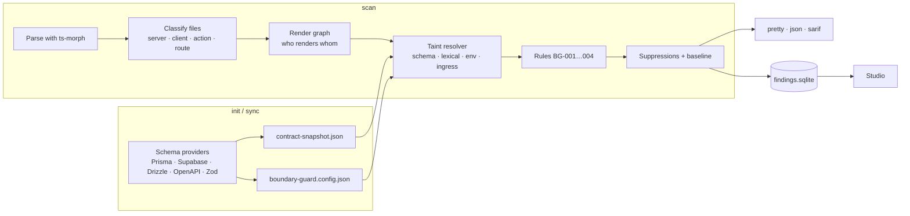
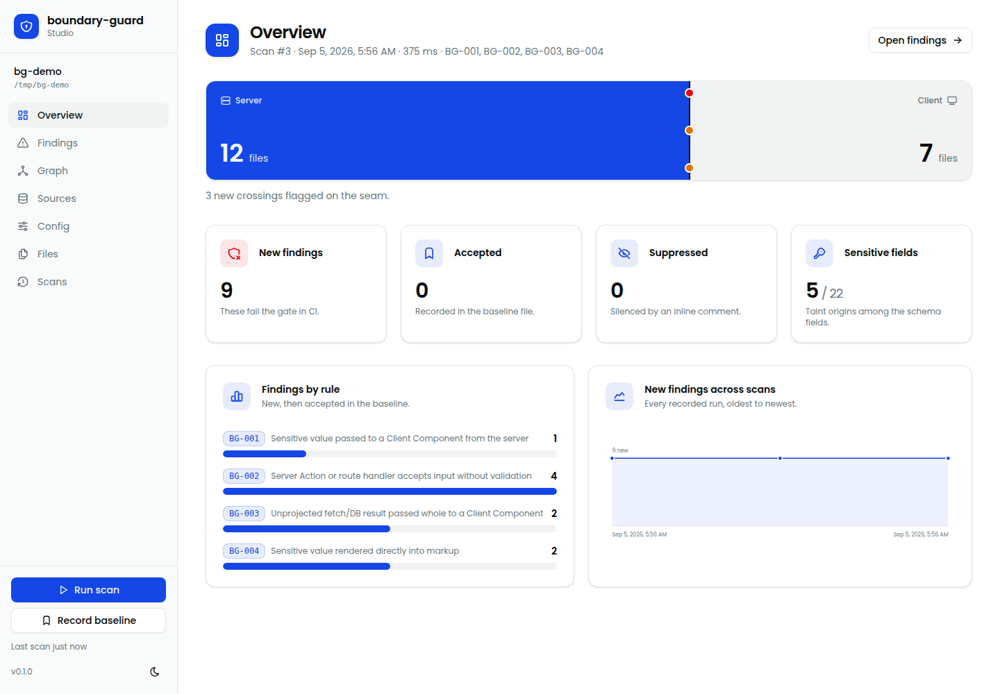
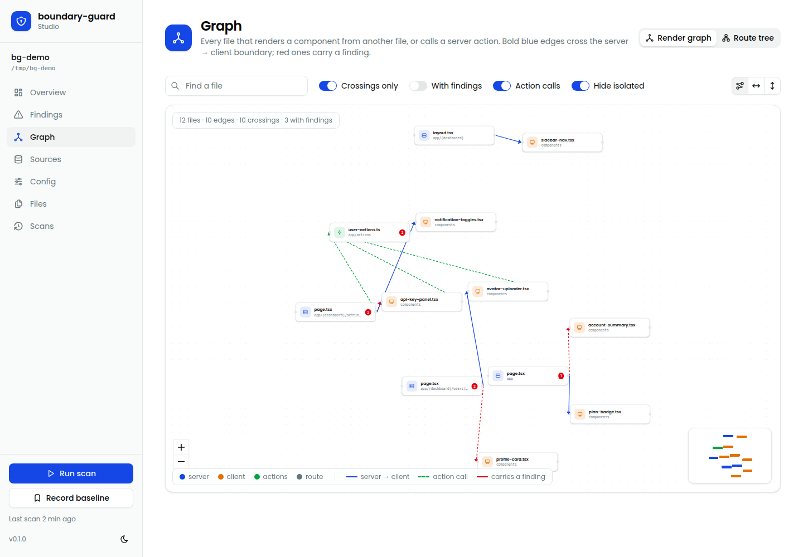
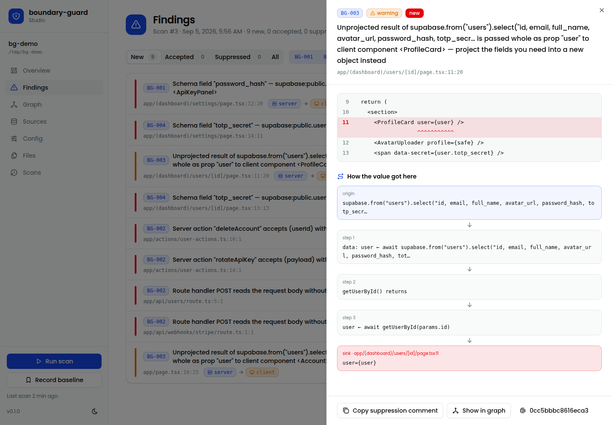

# boundary-guard

Static analysis for the React Server Components boundary. It finds sensitive data — password hashes, tokens, API keys, whatever your schema says is secret — crossing from server code into client components in Next.js App Router apps, and it does it before the code ships.

[](https://github.com/Ferhatmedtahar/boundary-guard/actions/workflows/ci.yml)
[](./LICENSE)

## Why

Server Components make this one line away from production:

```tsx
export default async function Page() {
  const user = await db.user.findUnique({ where: { id } });
  return <ProfileCard user={user} />; // "use client"
}
```

Every prop of a client component is serialized into the RSC payload and sent to the browser — `password_hash`, `stripe_customer_id`, `refresh_token` included. TypeScript is happy. ESLint has no idea which fields are sensitive. boundary-guard reads your schema (Prisma, Supabase, Drizzle, OpenAPI, Zod) to learn which fields are, walks the render graph, and flags every crossing with the path the value took.

## What it finds

| Rule       | Severity | Catches                                                                                                                                                                     |
| ---------- | -------- | --------------------------------------------------------------------------------------------------------------------------------------------------------------------------- |
| **BG-001** | error    | A sensitive value — schema field, sensitive-looking name with a known origin, non-`NEXT_PUBLIC_` env var — passed as a prop, spread or child to a `"use client"` component. |
| **BG-002** | error    | A server action or route handler that reads its input without calling a configured validator (zod, valibot, yup, joi, arktype, next-safe-action, or your own).              |
| **BG-003** | warning  | A whole `fetch()` / database result passed as a prop to a client component instead of a projection of the fields it needs. Needs no schema at all.                          |
| **BG-004** | error    | A sensitive value rendered straight into markup — JSX text or an attribute.                                                                                                 |

Every finding comes with a code frame and the provenance chain: `supabase.from("users").select(…)` → `data: user` → `getUserById() returns` → `targetUser` → `<ProfileScreen user={targetUser} />`.

## Sixty seconds

```bash
npm install --save-dev boundary-guard

npx boundary-guard init      # detects Next.js, picks your schema provider, seeds the sensitive fields
npx boundary-guard scan      # findings with code frames and the path the value took
npx boundary-guard studio    # local dashboard: findings, render graph, config editing
```

`init` writes two files you commit: `boundary-guard.config.json` (your decisions — keywords, pinned fields, rule toggles) and `.boundary-guard/contract-snapshot.json` (every field the provider extracted). Scan history goes to `.boundary-guard/findings.sqlite`, which `init` adds to `.gitignore`.

No schema? `scan` still works: sensitivity falls back to name heuristics (`password`, `token`, `secret`, `api_key`, …) and BG-003 doesn't need one.

```
app/[locale]/(private)/profile/me/page.tsx
  93:34  warn   BG-003  Unprojected result of supabase.from("users").select(`id, first_name, … is passed
                        whole as prop "user" to client component <StudentProfileScreen>
    92 |   } else {
  > 93 |     return <StudentProfileScreen user={targetUser} />;
       |                                  ^^^^^^^^^^^^^^^^^
        ↳ targetUser ← await getUserById(currentUser.id)
        ↳ getUserById() returns
        ↳ data: user ← await supabase.from("users").select(`id, first_name, …
```

## How it works



Three trust tiers, highest wins: what the AST says (a `"use client"` directive, a `.parse()` call), then runtime schemas (Zod, OpenAPI), then TypeScript types. The design is written up in [`docs/adr/`](./docs/adr/) and the system diagram in [`docs/c4/`](./docs/c4/).

## Configuration

`boundary-guard.config.json`, written by `init`, editable by hand or in Studio:

```json
{
  "version": 1,
  "frameworkAdapter": "nextjs-app-router",
  "providers": [{ "id": "supabase", "typesPath": "types/database.types.ts" }],
  "keywords": {
    "include": ["password", "secret", "token", "iban", "mot_de_passe"]
  },
  "sensitiveFields": {
    "include": ["supabase:public.users.iban"],
    "exclude": ["public_token"]
  },
  "sanitizers": ["zod", "next-safe-action", "sanitizeUser"],
  "rules": { "BG-003": false }
}
```

- **keywords** — name patterns in any language. Four letters or more match inside a name (`token` → `accessToken`); three or fewer match whole words only (`ssn`).
- **sensitiveFields.include / exclude** — exact field names or origins (`provider:schema.table.column`). Exclude always wins.
- **sanitizers** — calls that break the taint chain and count as validation for BG-002.
- **rules** — set an id to `false` to skip it.

`sync` refreshes the snapshot when the schema changes; it never touches the config.

## Living with findings

```tsx
{
  /* boundary-guard-disable-next-line BG-001 reason="public share token" */
}
<ShareCard token={link.share_token} />;
```

Adopting on an existing codebase? Record what's there and only fail on new findings:

```bash
npx boundary-guard baseline       # writes .boundary-guard/baseline.json — commit it
npx boundary-guard scan --fail-on-violation
```

Findings are matched by a fingerprint of rule + file + sink text, not line numbers, so unrelated edits don't resurrect them. `fix --suppress BG-002 --reason "…"` inserts suppression comments for a whole rule at once when that's the honest answer.

## CI

```yaml
- run: npx boundary-guard scan --fail-on-violation --format sarif --output boundary-guard.sarif
- uses: github/codeql-action/upload-sarif@v3
  if: always()
  with:
    sarif_file: boundary-guard.sarif
```

`--strict` also fails when the project was never `init`-ed. `scan --staged` is the pre-commit shape (rules only on staged files, whole project still parsed); `scan --diff --base origin/main` is the PR shape.

## Commands

| Command                                                                               | Does                                                                                  |
| ------------------------------------------------------------------------------------- | ------------------------------------------------------------------------------------- |
| `init [path]`                                                                         | Detect the framework, choose providers, write config + snapshot, manage `.gitignore`. |
| `scan [path] [--staged\|--diff] [--fail-on-violation] [--format pretty\|json\|sarif]` | Run the rules.                                                                        |
| `sync [path]`                                                                         | Re-extract the schema snapshot.                                                       |
| `baseline [path]`                                                                     | Accept every current finding.                                                         |
| `doctor [path]`                                                                       | Eleven health checks with a hint each; exit 1 on a failure.                           |
| `trace <file[:line]> [path]`                                                          | Why is this line flagged — the path from origin to sink.                              |
| `query [sql] [path]`                                                                  | Read-only SQL over the scan history.                                                  |
| `watch [path]`                                                                        | Rescan whatever you save.                                                             |
| `fix --suppress <rule> --reason <text>`                                               | Insert suppression comments for a rule.                                               |
| `studio [path]`                                                                       | The dashboard, bound to localhost.                                                    |

## Studio

`boundary-guard studio` serves a local dashboard over the same files the CLI uses: findings with code frames and the dataflow, the render graph (which server file renders which client component, which edges carry a finding), the App Router tree, schema fields with pin/ignore switches, and the config with a save bar. It binds to `127.0.0.1` only.





## Limits, honestly

- Next.js App Router only. Pages Router, Remix and others are not detected.
- Taint follows values through assignments, destructuring, object literals, function returns, `.then` chains, and one hop through a function parameter, bounded to one import hop and one call level. A parameter resolves from call sites in the same file, so a helper defined beside the page that renders it is followed and one imported from another module is not.
- Keyword sensitivity is a recall problem: `pwd` in a non-conventional vocabulary won't match until you add it — that's what `keywords` and `sensitiveFields.include` are for.
- About 13 seconds and 1 GB for a thousand files; every scan parses the whole project.

## Contributing

See [`CONTRIBUTING.md`](./CONTRIBUTING.md). Bugs and false positives are the most useful reports — the issue templates ask for the snippet that triggered them.

## License

[MIT](./LICENSE)
