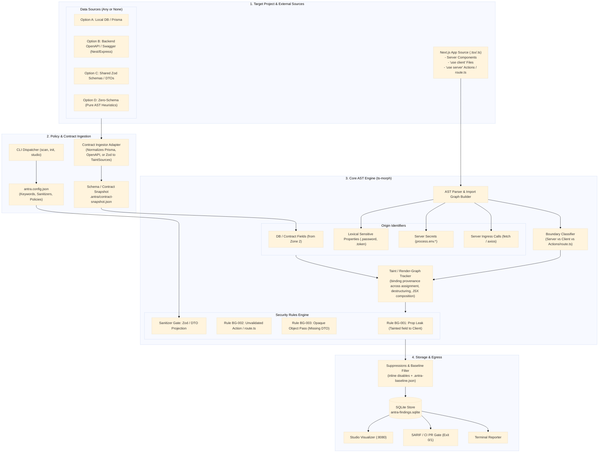

# System Context — Schema-Optional Ingestion

Settled architecture for `antra`'s scan pipeline. Generalizes ingestion from "Prisma schema" to "any data contract, or none" (BFF / Express / NestJS backends, zero-schema `fetch()`-only apps). See [ADR-002](../adr/0002-schema-optional-ingestion-and-trust-tiers.md) for the reasoning and known limitations behind this shape.

Two additions versus the diagram this was drafted from:

1. **`P1` Taint / Render-Graph Tracker** is now its own node, not folded into the Boundary Classifier. Classifying a file as Server/Client/Action tells you nothing about whether a specific _binding_ traces back to a tainted source through destructuring, reassignment, or JSX composition — that's a distinct pass (`ast/render-graph.ts`) and deserves its own box so the diagram doesn't imply classification and taint propagation are the same algorithm.
2. **`E1` Suppressions & Baseline Filter** sits between the rules engine and storage. `engine.ts`'s own pipeline already does `applySuppressions(rawFindings, project)` before persisting — the earlier diagram routed `RulesEngine --> D1` directly, which contradicts that. In zero-schema / heuristic mode this stage isn't optional polish: lexical + ingress-tracking rules will over-fire on legitimate code, and without suppressions + `baseline` wired in from day one, the tool is too noisy to adopt.

